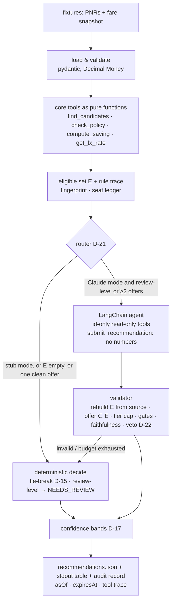

# Rebooking Copilot: Design

> Status: **v0 skeleton** (bullets to build against; full prose in v1 after the build) · Policy version: v1 · Last updated: 2026-10-18
>
> **TL;DR**
> - An **LLM agent over deterministic tools** reviews each booking against the fare snapshot and recommends REBOOK,
>   DO_NOT_REBOOK or NEEDS_REVIEW, with the chosen fare, a rationale, a confidence band and the net saving (D-19).
> - **Code owns every number, every hard constraint and the eligible set.** The agent decides only inside that set, through
>   id-only tools, and a validator re-checks its answer against an independently rebuilt set (D-07, ADR-0004/0007).
> - **Money safety:** currency-tagged decimals, the existing ticket's fee × passengers, cash-only savings by default, abstain when unsure.
> - **Recommend-only:** a human approves every rebook (D-09). Stub mode is deterministic and runs offline with no key;
>   Claude mode is optional (D-02, D-23).
> - **Built:** the money and eligibility core, the agent with a validator and fallback, and tests. **Stubbed:** FX rates and the
>   LLM in tests. **Described:** the production reshopping pipeline and the approve → execute flow.

## 1. Problem framing
- **A good rebooking (our definition):** an eligible offer (§4) whose code-computed *cash* net saving clears
  max(25, 5% of total paid) in the ticket's currency, with every trade-off listed and approved by a human (D-09, D-10, D-13).
- **Left to the business, with our defaults meanwhile:** cash vs credit, whose saving it is and the cost of a review, the fee
  basis, cross-currency exchange, acceptable downgrades, volume. See [open questions](docs/open-questions.md).
- **Fixture walk-through.** A projection from the recorded decisions; the golden tests in `/slice decision` decide.

| PNR | Eligible set | Path | Outcome (stub / Claude) | Deciding reason |
|---|---|---|---|---|
| QX7T2A | {OF-1001, clean} | deterministic | NEEDS_REVIEW / same | net 80 USD, but a non-refundable residual is credit under `cash_only` (D-10) |
| LM9P4C | ∅ | deterministic | DO_NOT_REBOOK / same | OF-2001 has fewer bags (D-11) and net −90 |
| RT5K8B | {OF-3001, clean, via FX} | deterministic | REBOOK if the stub rate ≥ 1.0048 USD/EUR after spread / same | FX via a stub (D-12); FX use lowers confidence (D-17) |
| ZC3N1D | {OF-4001, review-level} | **agent** (Claude mode) | NEEDS_REVIEW / REBOOK at MEDIUM at most | lost refundability is review-level (D-11, D-16) |
| HB6W9E | ∅ | deterministic | DO_NOT_REBOOK / same | OF-5001 net −90; OF-5002 fewer bags, +875 min, next-day arrival (D-13, D-14) |

## 2. Approach & architecture

| Component | Responsibility | Decisions |
|---|---|---|
| Loader | Parse and validate the fixtures; malformed → NEEDS_REVIEW `DATA_INCONSISTENT` | D-00c |
| Core tools | Candidates, tiers, money breakdown, FX: pure and deterministic | ADR-0005, ADR-0006 |
| Eligible set + ledger | Build E, a per-run seat ledger, the fingerprint | D-24 |
| Router | Choose the deterministic path or the agent | D-21 |
| Agent | Investigate review-level or multi-offer cases; submit a choice and a rationale | D-19, D-20, D-25 |
| Validator | Re-check the agent's answer against an independently rebuilt E; fall back on failure | D-07, D-22 |
| Confidence | Bands from code signals; the LLM can only lower them | D-17 |
| Output | A schema-validated JSON file, a table, and an audit record | D-05 |

**Considered alternatives** (D-19):
- **A, a safety-first pipeline with one structured LLM call:** the simplest and cheapest boundary. Not chosen, because the agent
  gets a real investigative role. B's core is written so that A is B without the agent loop.
- **The Hybrid of A and B:** A everywhere, the agent only for hard cases. The D-21 router already gets most of this.
- **C, scale-first:** not an alternative but the production shape (§5).

## 3. Where the LLM is, and isn't
| Step | Owner | Why | Failure mode → guard |
|---|---|---|---|
| Parse, match, tiers, money, FX, E | Code | Exact, testable, money-safe | Bad data → NEEDS_REVIEW |
| Route a case to the agent | Code | Spend the LLM where judgement pays | — |
| Which facts to fetch; weigh review-level trade-offs; choose an offer | **LLM agent** | Real judgement across factors | Loops, tool misuse → id-only tools, a 6-turn / 30 s budget, then fallback |
| Rationale text | LLM (template in stub mode) | Language work | Invented numbers → faithfulness check → template |
| Final gate: offer ∈ E, tier cap, settlement and threshold | Code | D-07 | Any failure → deterministic fallback, reason recorded |
| Confidence | Code | Self-reported confidence isn't trustworthy | The LLM can only lower it |
- **Prompt:** `prompts/rebooking_agent_v1.md` (versioned; built in `/slice reasoner`). Inputs are a delimited FACTS block plus tool
  results, both treated as untrusted data. The submit schema has no numeric fields.
- **Model, effort, structured-output mechanism:** chosen in `/slice reasoner` against the current API reference (D-25).

## 4. Correctness & money safety
- **Money:** `Decimal` amounts tagged with a currency; cross-currency arithmetic raises; per-passenger and total amounts are separate fields (D-00b).
- **Input contract:** each bad record is rejected on its own with `DATA_INVALID` / `DATA_INCONSISTENT` / `UNSUPPORTED_ITINERARY`, never
  coerced, and becomes NEEDS_REVIEW. Floats, unknown fields and unknown currencies are rejected (D-26).
- **Net** = (paid per passenger − offer per passenger) × passengers − *existing ticket's* change fee × passengers (D-18, provisional).
- **Settlement:** `settlementPolicy`, default `cash_only`. A credit residual is reported separately and leads to NEEDS_REVIEW (D-10).
- **FX:** an injected provider stubbed with timestamped rates plus a spread margin; the rate, source and as-of are recorded (D-12).
- **Policy v1** (ADR-0005):

| Rule | Tier | Ref |
|---|---|---|
| Fewer included bags | ineligible | D-11 |
| Another flight departing more than ±60 min away, or arriving on a later day | ineligible | D-14 |
| Net < max(25, 5% of total paid) | ineligible | D-13 |
| Seats < passengers, or lost in the seat ledger | ineligible (`SEAT_CONTENTION`) | D-24 |
| Departs less than 24 h after as_of (local time read as UTC+14) | ineligible (`DEPARTS_TOO_SOON`) | D-33 |
| Cabin/product downgrade · lost refundability · carrier change · added stop · another flight within ±60 min · more than 60% cheaper than paid | review-level: agent REBOOK capped at MEDIUM; stub → NEEDS_REVIEW | D-11, D-14, D-16, D-18, D-34 |
| None of the above | clean: REBOOK possible, HIGH reachable | ADR-0005 |
- **Seat ledger** (D-24, D-31): deferred acceptance across the run. Bookings propose to their eligible offers in
  preference order; each offer keeps the proposers that fit its seats, by REBOOK-bound first, then saving in the
  offer's currency, then input index. Seats are never oversold, and amounts in different currencies are never compared.
- **Robustness** (D-35, from the money-safety review): duplicate ids rejected, FX quotes validated, bad data on the route
  → OFFER_DATA_REJECTED, per-booking isolation (EVALUATION_ERROR), a fixed Decimal context, bounded amounts. Each has a regression test.
- **Against hallucinated savings:** every output number is copied from the code breakdown; the agent's tools never take amounts;
  the validator rebuilds E independently; there's a faithfulness check; the veto rule makes missed savings visible (D-22).
- **Invariants to test:**
  - REBOOK ⇒ the offer is in E, whatever the reasoner returns.
  - The saving can be recomputed from the output.
  - Monotonicity: raising a price or fee never pushes a decision toward REBOOK.
  - Stub-mode determinism.
  - One result per PNR.
  - Adversarial fake-agent runs (an ineligible id, invented numbers, invalid output, an exhausted budget) all end in the fallback.
- **Before any real action** (described): re-price, re-validate, idempotency key, buy the new ticket before releasing the old one, caps, kill switch.

## 5. Scale, cost & observability
- **Production shape = option C:** incremental, event-driven reshopping (ticketing or changes, a scheduled reshop by priority
  tier, fare-change events). Shopping is by market key with a cached snapshot, the core is stateless, the fingerprint skips
  unchanged cases, and batch LLM calls handle sweeps while synchronous calls handle near-departure cases.
- **The bottleneck is human review, not tokens:** `review hours/day = B · f · q · m / 60`. With f = 1 reshop/day, q = 2% new
  queue items and m = 3 min, that is 10 h at 10k bookings, **1,000 h at 1M**, and 50,000 h at 50M (computed with a script). Hence ranking the review queue and an eventual auto tier.
- **v1 will add:** shops/day and QPS against supplier limits, the LLM cost formula with stated inputs and current prices, and the SLIs.
- **Observability (v0 list):**
  - tier and decision mix, fallback rate by reason, faithfulness failures;
  - agent turn and budget exhaustion, and alerts on any ineligible-id submission;
  - human overturn rate (especially MEDIUM approvals), estimated vs re-priced saving;
  - expired-before-review rate, cost per PNR.

## 6. Autonomy & human-in-the-loop
- **Today: recommend only.** Every REBOOK is a recommendation that a human approves (D-09).
- **Production flow** (described, on LangGraph, ADR-0008): `interrupt()` for approval → re-price → re-validate → execute
  (idempotency key; buy the new ticket before releasing the old one) → reconcile. State is checkpointed across a review that may take days.
- **Before any auto tier:** only HIGH-confidence clean cases, after shadow mode shows high precision, with caps and a kill switch, and rollback where the airline allows it.

## 7. Assumptions & open questions
| # | Assumption / question | Our default | Impact if wrong | Business choice? | Ref |
|---|---|---|---|---|---|
| 1 | How a residual comes back | Refundable → cash, non-refundable → credit; only cash counts | QX7T2A flips | yes | D-10, Q1 |
| 2 | Whose saving it is, and the review cost | The payer; max(25, 5%) | The threshold moves | yes | D-13, Q2 |
| 3 | The fee basis | The existing ticket's fee × passengers | HB6W9E/OF-5002 −40 ↔ +110 | yes | D-18, Q3 |
| 4 | Exchanging across currency or point of sale | Allowed, via stub FX | RT5K8B may not be achievable | yes | D-12, Q4 |
| 5 | Acceptable downgrades | Only fewer bags is ruled out | Eligible set too wide or too narrow | yes | D-11, Q5 |
| 6 | Volume and reshop frequency | Scenarios of 10k / 1M / 50M | The §5 sizing | yes | Q6 |
| 7 | `amount` includes taxes | It's the comparable full amount | Savings overstated | no | framing §6 |
| 8 | The as-of time | Injected, defaults to `capturedAt` | Everything marked departed | no | D-18 |

## 8. What I deliberately did not do, and what's next
| Area | Plan | Note |
|---|---|---|
| Typed models, Money, validating loader | **Built** (`/slice core`) | Money properties (hypothesis), per-record rejection, CLI loads fixtures |
| Matching, policy tiers + rule trace, money breakdown, FX provider (mock), seat ledger, confidence, fingerprint, expiry | **Built** (`/slice decision`) | 186 spec-derived tests: golden per fixture booking, invariants (hypothesis), seat contention, FX, settlement variants |
| LangChain agent, tools, validator, prompt, fallback | Built (Claude mode optional) | `/slice reasoner` |
| Tests: golden, invariants, adversarial fake agent, multi-offer cases | Built | `test-engineer` |
| Priority score, scheduler, queues, batch calls, caching, shadow mode | Described | §5 |
| FX rate plausibility against a reference rate | **Not done** (known limitation) | A plausible-looking misquote still passes; production cross-checks two sources (D-35) |
| The approve → execute flow (LangGraph), idempotency, kill switch | Described | §6 |
To be updated after each slice.

## 9. AI usage note
_Written in `/finalize` from [docs/AI_USAGE_LOG.md](docs/AI_USAGE_LOG.md)._

## 10. Architecture decision records
The architecture-significant decisions are in [`docs/adr/`](docs/adr/README.md). Each one has a **"Depends on (team & context)"**
section saying where a real team could reasonably decide differently.
| ADR | Decision | Depends on (one line) |
|---|---|---|
| [0001](docs/adr/0001-python-3-14.md) | Python 3.14 | The team's language experience, the existing platform, runtime version policy |
| [0002](docs/adr/0002-llm-integration-stub-plus-claude.md) | Stub by default, optional Claude | Provider and data-protection approval for PNR data, cost/latency budget |
| [0003](docs/adr/0003-runtime-dependencies.md) | Mainstream libraries allowed | Dependency and supply-chain policy, the code's expected lifetime |
| [0004](docs/adr/0004-llm-decision-authority.md) | The LLM decides inside a code-built eligible set | Risk appetite and accountability, eval maturity |
| [0005](docs/adr/0005-eligibility-tiers-and-confidence-cap.md) | Tiers and a MEDIUM cap on LLM approvals | Client contracts and travel policy, review capacity |
| [0006](docs/adr/0006-money-model-settlement-fx-fees.md) | Money model: settlement, FX, fees | Ticketing and settlement practice, point of sale, treasury FX policy |
| [0007](docs/adr/0007-agent-over-deterministic-tools.md) | An agent over deterministic tools | The team's agent and LLM-ops experience, cost budget, tracing tooling |
| [0008](docs/adr/0008-langchain-for-the-agent.md) | LangChain for the agent | Familiarity, provider strategy, tolerance for framework churn |
