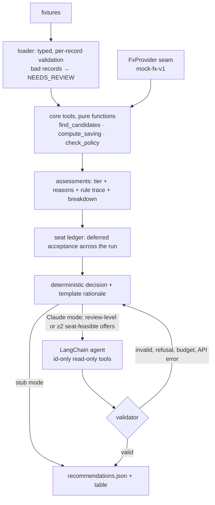

# Rebooking Copilot: Design

> Status: **v1**, matching the code at this commit · Policy version: v1 · Last updated: 2026-10-18
>
> **TL;DR**
> - For each ticketed booking, the copilot recommends **REBOOK, DO_NOT_REBOOK or NEEDS_REVIEW**. Each recommendation carries
>   the chosen fare, the net saving, a confidence band, machine-readable reasons, a rationale and a full audit trail.
> - **Code owns every number, every hard constraint and the set of eligible offers.** An optional Claude agent decides only
>   *inside* that set, for the cases that need judgement. A validator re-checks every answer and falls back to the
>   deterministic decision on any doubt (D-07, D-40, ADR-0004/0007/0009).
> - **Money safety comes first:**
>   - currency-tagged decimals, and the existing ticket's change fee × passengers;
>   - only cash counts as a saving by default;
>   - no flights that leave within 24 h;
>   - abstain (NEEDS_REVIEW) on invalid data, a missing or stale FX rate, or a trade-off a human should weigh.
> - **It recommends, it never executes** (D-09). Stub mode is deterministic and runs offline with no key, which is how the
>   example output was produced. Claude mode is opt-in.
> - **Built:** the risky core, the agent with its validator, JSON output, and 320 tests. **Described:** production
>   reshopping at scale and the approve → execute flow.

## 1. Problem framing
A **good rebooking** must meet three conditions:
- the offer passes every hard constraint (§4);
- the saving is computed by code, comes back as **cash**, and clears max(25, 5% of total paid) in the ticket's currency;
- every trade-off is listed for the human who approves it (D-09, D-10, D-13).

"Cheaper" is not enough. All six offers in the fixtures are cheaper than what was paid:
- three lose money once change fees and passengers are counted;
- one trades away refundability;
- one would come back as credit rather than cash;
- only one becomes a REBOOK.

Some choices belong to the business, and I would put them to the assessors: cash vs credit, whose saving it is,
which fee applies, cross-currency exchange, acceptable downgrades, and volume. The questions are drafted in
[docs/questions-email.md](docs/questions-email.md) (not sent). Each runs on a stated, configurable default, and every
default cites its decision ([open questions](docs/open-questions.md), [decision log](docs/decisions.md)).

**Walk-through: the real output of `uv run rebooking-copilot`** (stub mode):

| PNR | Outcome | Why |
|---|---|---|
| QX7T2A | NEEDS_REVIEW, OF-1001, 80.00 USD, LOW | Same flight, net +80 after the 100 fee. But the ticket is non-refundable, so the residual comes back as credit, and `cash_only` doesn't count credit |
| LM9P4C | DO_NOT_REBOOK, HIGH | OF-2001 has no included bag (a hard block) and nets −90 for 2 passengers. It is also basic economy on another flight |
| RT5K8B | **REBOOK**, OF-3001, 252.04 EUR, MEDIUM | Same flight and fare. 2,100 USD × 0.9276 (mock FX) = 1,947.96 EUR against 2,200 EUR paid. Confidence is lowered one band because FX was used. This holds only if a USD fare can be bought for a EUR ticket (Q4, open) |
| ZC3N1D | NEEDS_REVIEW, OF-4001, 140.00 USD, LOW | Saves 140, but loses refundability, which is a review-level trade-off. In Claude mode this booking goes to the agent, which may recommend REBOOK (MEDIUM at most) |
| HB6W9E | DO_NOT_REBOOK, HIGH | OF-5001 nets −90 after the 150 fee. OF-5002 is the decoy: another carrier, an extra stop, a next-day arrival, no bag, and −40 with the *ticket's* fee (+110 with the offer's) |

## 2. Approach & architecture

| Module | Responsibility |
|---|---|
| `money.py`, `models.py`, `loader.py` | Exact money; typed records; every bad record rejected individually, never coerced (D-26, D-35) |
| `fx.py` | API-shaped `FxProvider`; the mock returns executable rates; quotes are validated before use (D-27, D-35) |
| `policy.py` | The deterministic core tools: matching, the money breakdown, tiers and the rule trace (ADR-0005/0006) |
| `decision.py` | Seat ledger, deterministic choice, confidence, fingerprint; routes cases to the agent and validates its answers |
| `reasoning.py`, `agent.py`, `prompts/` | What the agent sees, its tools, the explicit LangChain loop, the faithfulness check (ADR-0009) |
| `output.py`, `schemas/` | `recommendations.json`, validated against the committed JSON Schema (D-05) |

**Considered alternatives** (D-19):
- **A safety-first pipeline with one structured LLM call (option A).** It is the cheapest boundary, at roughly 2.5× fewer tokens
  per decided case by the architect's estimate. I didn't
  choose it because the agent gets a real investigative role. The core is written as named tools, so A is this design minus the loop.
- **A hybrid.** A runs everywhere and the agent only on hard cases. The D-21 router already captures most of that.
- **Scale-first (option C).** It is not an alternative to this design but its production shape (§5).

## 3. Where the LLM is, and isn't
| Step | Owner | Why | Guard |
|---|---|---|---|
| Parse, match, tiers, money, FX, seats | Code | Exact and testable; a wrong number is a money bug | Rejection → NEEDS_REVIEW |
| Decide which bookings need judgement | Code (D-21) | Spend tokens only where rules leave a real choice | — |
| Weigh review-level trade-offs; choose among eligible offers | **LLM agent** | Judgement across several factors | Id-only read-only tools; 6 turns / 30 s; fallback |
| Rationale text | LLM (template in stub mode) | Language work | A typed number check (below); the code's own summary comes first |
| Final gate and confidence | Code | D-07; self-reported confidence isn't evidence | The agent's ceiling can only lower confidence |

- **Prompt.** [`rebooking_agent_v2.md`](src/rebooking_copilot/prompts/rebooking_agent_v2.md) is versioned, and its version
  and hash are recorded per recommendation (v1 is kept for comparison). It explains the agent's role, including whose
  saving it is and who bears the inconvenience. It tells the agent to treat FACTS and tool results as data and to choose
  NEEDS_REVIEW if a value reads like an instruction. It explains each reason code: `PRICE_ANOMALY` and a credit saving
  under `cash_only` are never REBOOK. Its rules: only listed offer ids; amounts copied exactly with their currency (no
  differences, percentages or number words); prefer NEEDS_REVIEW to a guess; submit exactly once.
- **Runtime** (ADR-0009, checked against the current API reference):
  - `claude-sonnet-5-5` at effort `medium`;
  - `ChatAnthropic.bind_tools(tool_choice="auto", strict=True)`, because forced tool choice is a 400 on Sonnet 5.5;
  - the server-side refusal fallback is on, and the model that actually served the answer is recorded in `reasoner`;
  - the loop is append-only, so thinking blocks are passed back unchanged; a text-only reply gets one reminder;
  - no SDK retries; the 30 s budget is checked before each call, so a call starts only if its 10 s timeout still fits;
  - prompt caching is requested for the stable system prompt plus tools;
  - it needs `ANTHROPIC_API_KEY`, because LangChain passes the key explicitly and `ant auth` profiles aren't read (D-41).
- **The submit tool has no numeric fields:** `chosenOfferId | null`, `decision`, `rationale`, `confidenceCeiling`. Every
  amount in the output is copied from the code's breakdown.
- **Validator order** (D-39, D-40):
  1. The offer is in the booking's seat-feasible eligible set.
  2. REBOOK names an offer.
  3. The settlement gate passes.
  4. REBOOK on a `PRICE_ANOMALY` offer is refused: a possible feed error is not a trade-off to judge (D-40).
  5. The rationale passes the number check.
  6. A review-level REBOOK is capped at MEDIUM; the agent's ceiling can only lower confidence.

  Declining a clean saving becomes NEEDS_REVIEW with `LLM_DISAGREES_WITH_POLICY` (D-22). A credit saving the agent
  declines stays visible as NEEDS_REVIEW with `SAVING_AS_CREDIT`, and every non-REBOOK carries a reason (D-41). Anything
  else is a full fallback, with the reason in `fallbackReason`.
- **The number check** (D-41): every amount in the agent's rationale must match an (amount, currency) pair from this
  booking's facts exactly. Ids, flight numbers, dates and the FX source are stripped first; percentages and number words
  are rejected. Tool error messages never echo the agent's arguments, so it can't launder a number through an error,
  and offer ids must match a strict pattern, so supplier data can't close the FACTS block. **Limit:** the check can't
  tell whether a real amount is attributed to the right thing (calling the fee the saving passes). The output therefore
  puts the code's own summary first and the agent's text after it as "Agent's view: …", and a test documents the limit.
- **Confidence** comes from code signals: FX use, margin over the threshold, snapshot age and the tier (D-28). It is
  never the model's self-report.

## 4. Correctness & money safety
**Money model.**
- **Representation:** Decimal amounts tagged with a currency. Arithmetic runs in a fixed local Decimal context, and
  rounding happens only for display.
- **The formula** (D-18; the fee basis is still provisional):
  net = (paid per passenger − offer per passenger in the ticket's currency) × passengers − the *existing ticket's*
  change fee × passengers. The offer's own fee only matters for a later change.
- **Settlement** (D-10): refundable → cash, non-refundable → credit. Under the default `cash_only`, a credit saving is
  reported but can never become REBOOK.
- **FX** (D-12, D-27): through the `FxProvider` seam. The quote must match the requested pair and be fresh. Amounts in
  different currencies are never added or compared, so a missing rate means NEEDS_REVIEW.

**Policy v1** (ADR-0005), versioned and configurable:

| Rule | Tier | Ref |
|---|---|---|
| Fewer included bags | ineligible | D-11 |
| Another flight more than ±60 min away, or a later-day arrival | ineligible | D-14 |
| Counted net < max(25, 5% of total paid) | ineligible | D-13 |
| Seats < passengers, or taken by higher-priority bookings in the run | ineligible | D-24, D-31 |
| Departs less than 24 h after as_of (local time read as the earliest zone, UTC+14) | ineligible | D-33 |
| Cabin or product downgrade · lost refundability · carrier change · added stop · other flight within the window | review-level | D-11, D-14 |
| More than 60% cheaper (a possible feed error) | review-level; the agent can't approve it | D-34, D-40 |
| None of the above | clean | — |

**How a wrong or hallucinated saving is prevented.**
- **Every output number can be recomputed** from the breakdown in the same output, and a test checks this.
- **The model never supplies a number or approves outside the set code built.** Its tools take ids only, and its submit tool has no numbers.
- **The seat ledger never oversells.** It uses deferred acceptance, with REBOOK-bound bookings first, ranked by saving in
  the offer's currency, so amounts in different currencies are never compared. A seat the agent frees by choosing
  another offer is re-offered to the bookings it didn't see (D-41).
- **Duplicates are rejected.** Duplicate offer ids or locators would otherwise let seats be sold twice.
- **Incomplete data means abstain.** A rejected offer on the booking's route, or one that couldn't be priced (no usable
  FX rate), means the picture is incomplete, so the booking abstains or drops a confidence band (D-41).
- **Errors are contained.** An error in one booking yields NEEDS_REVIEW for that booking only, and a provider failure is
  an abstain, never a crash.

**Tests: 320, with no network access.**
- **Golden cases:** one per fixture booking.
- **Property tests (hypothesis):** recomputable savings; no REBOOK on a hard block; monotonicity per booking (with two
  documented exceptions, D-34 and D-35); stub-mode determinism; one result per input.
- **Seat contention.**
- **Adversarial fake-agent runs:** an unknown or another booking's offer, invented numbers (including one smuggled through
  a tool error), a bad schema, text-only answers, a refusal, an exhausted turn or time budget, API errors, tool-argument
  abuse, a credit approval, a `PRICE_ANOMALY` approval, and seat theft. All of them end in the fallback.
- **The production client, offline:** the real `ChatAnthropic` runs against canned API responses. The tests check the
  request shape, thinking replay, parallel tool results, a refusal with its category, `max_tokens`, and the refusal-fallback block.
- **Two review rounds:** an independent money-safety review found 10 issues before the agent existed. A second round
  (money safety, the LLM boundary, and an assessor's read) found the issues behind D-40 and D-41. Every reproduced finding
  is fixed with a regression test, and key fixes were mutation-checked.

**Before any real action** (described, not built):
- re-price and re-validate at execution time;
- use an idempotency key per (PNR, offer, attempt);
- buy the new ticket before releasing the old one;
- enforce per-run and per-day caps, and keep a kill switch.

## 5. Scale, cost & observability
**Production shape.**
- **Triggers:** reshopping is incremental and event-driven: a booking is ticketed or changed, a reshop comes due by
  priority tier, or a fare changes in a market.
- **Shopping** happens per market key against a fare cache with a TTL, not per PNR.
- **The core is stateless per market partition** (origin, destination, date): the seat ledger only couples bookings
  that compete for the same offers, so partitions scale horizontally.
- **The fingerprint** lets unchanged cases reuse their last recommendation. It is per booking and doesn't cover seat
  contention, so a reused recommendation is still re-checked against the ledger.
- **LLM calls** use the Batches API for sweeps and synchronous calls near departure.

What breaks first is **supplier limits** (look-to-book ratios) and **human review capacity**, not compute.

**Cost model.** Sizes are measured from the real prompt, tool schemas, FACTS and tool results; tokens ≈ characters / 4.
A typical agent run with prompt v2 has three turns (check_policy → compute_saving → submit), with about 7.1k input and
1k output tokens.

On Sonnet 5.5 ($2 / $10 per MTok) that is **≈ $0.024 per routed booking, or 0.10% of the smallest saving worth
surfacing.** The worst case, 6 turns with no submission, is ≈ $0.058.

The scenario inputs below are assumptions, to be replaced with real volumes (Q6):
- reshops per booking per day = 0.2 × 4 (departing within 14 days) + 0.4 × 1 (in 15–60 days) + 0.4 / 7 (later) = 1.26;
- 2% of reshops reach the agent;
- 30% of those have a changed fingerprint;
- the Batches API halves the price;
- 2% of bookings per day become a review item, at 3 minutes each.

| Active bookings | Shops/day | Supplier QPS | LLM $/day (no reuse → reuse → batch) | Review hours/day |
|---|---|---|---|---|
| 10k | 12.6k | 0.1 | 6.10 → 1.83 → 0.91 | 10 |
| 1M | 1.26M | 14.6 | 610 → 183 → 91 | **1,000** |
| 50M | 62.9M | 728 | 30.5k → 9.1k → 4.6k | 50,000 |

The conclusion holds across scenarios. Tokens are cheap relative to savings, while review hours are not. That is why the
review queue must be ranked by saving and expiry, and why the first lever is an auto tier for HIGH-confidence clean cases
after shadow mode (§6). Prompt caching of the stable system prompt plus tools (≈ 1.5k tokens) is requested; whether it
applies depends on the model's minimum cacheable length, which only a live run shows (`cache_read_input_tokens`). The
figures above assume no caching.

**Observability.** Every recommendation carries:
- inputs and the snapshot time;
- the policy version;
- the rule trace and breakdown;
- the reasoner (the model that actually served), prompt version, tool trace and a per-call log (stop reason, tokens, latency);
- the fallback reason, the fingerprint, and asOf / expiresAt.

The metrics, and how to tell the system isn't working:

| Signal | Why it matters | Alert when |
|---|---|---|
| Tier and decision mix per route | Detects feed or policy drift | The share shifts sharply day over day |
| Fallback rate by reason; faithfulness failures | Agent health | Above a baseline; any ineligible-id submission |
| Agreement between stub and agent; human overturn rate (especially MEDIUM approvals) | Whether the agent adds value | Overturns rise |
| Estimated vs re-priced saving at execution | Snapshot staleness, wrong savings | The gap exceeds a tolerance |
| Recommendations expiring before review | Review capacity | The share grows |
| Cost per routed booking, turns per run | Token spend | Above budget |

## 6. Autonomy & human-in-the-loop
- **Today the copilot recommends; a human approves every rebook** (D-09). Confidence bands are defined so that only
  **HIGH, clean** cases could later qualify for an auto tier: same flight and product, a cash saving (under the default
  `cash_only` policy), no FX, a margin of at least 2× the threshold, a fresh snapshot.
- **Before turning one on:**
  - shadow mode logs "would auto-execute" and measures precision against human decisions;
  - then a capped rollout with a kill switch.
- **Production flow** (described, ADR-0008): LangGraph with `interrupt()` for approval, then re-price → re-validate →
  execute → reconcile, with state checkpointed across a review that may take days.

## 7. Assumptions & open questions
| # | Assumption / question | Default | Impact if wrong | Business choice? | Ref |
|---|---|---|---|---|---|
| 1 | How a residual comes back | Refundable → cash, non-refundable → credit; only cash counts | QX7T2A becomes REBOOK | yes | D-10, Q1 |
| 2 | Whose saving it is, and the cost of a review | The payer; max(25, 5%) | The threshold moves | yes | D-13, Q2 |
| 3 | The fee basis | The existing ticket's fee × passengers | HB6W9E/OF-5002: −40 ↔ +110 (blocked anyway on bags) | yes | D-18, Q3 |
| 4 | Exchanging across currency or point of sale | Allowed, with a mock executable FX rate | RT5K8B may not be achievable | yes | D-12, D-27, Q4 |
| 5 | Acceptable downgrades | Only fewer bags is ruled out; the rest go to review | The eligible set is too wide or too narrow | yes | D-11, Q5 |
| 6 | Volume and reshop frequency | The scenarios in §5 | The sizing | yes | Q6 |
| 7 | Lead time and timezones | 24 h, assuming the earliest timezone | Too strict close to departure | yes | D-33 |
| 8 | Anomalous prices | More than 60% off → review, never an agent approval | Misses or over-flags feed errors | yes | D-34, D-40 |
| 9 | `amount` includes taxes | It's the comparable full amount | Savings overstated | no | framing §6 |

## 8. What I deliberately did not do, and what's next
| Area | Status | Note |
|---|---|---|
| Money, typed models, validating loader | **Built** | 41 tests |
| Matching, tiers, breakdown, FX seam, seat ledger, confidence, fingerprint | **Built** | 186 spec-derived tests |
| Agent, validator, prompt, rationales, JSON output and schema | **Built** | 50 tests with a scripted fake model |
| Review findings (two rounds) | **Fixed** | 22 + 21 regression tests, including the production client run offline against canned API responses |
| A live Claude run | **Not done** | It costs money and needs approval; it's ready behind `--reasoner claude`. The request and response handling are tested offline; a live run would add the model's actual judgement, latency and cache behaviour |
| Real FX source; plausibility check against a reference rate | **Not done** | A plausible-looking misquote still passes; production would cross-check two sources |
| Multi-segment and round-trip itineraries, taxes, free-text fare rules | **Out of scope** | Rejected as `UNSUPPORTED_ITINERARY` or described here |
| Scheduler, market-key cache, batches, review queue ranking, shadow mode, approve → execute | **Described** | §5, §6 |

**Next, in priority order:**
1. Put the drafted questions to the assessors (settlement, fee basis, point of sale) and flip the provisional decisions.
2. Build an eval set for review-level cases from human decisions, then tune the prompt and effort on it.
3. Add a real FX source with a reference-rate check.
4. Rank the review queue and run shadow mode for the auto tier.
5. Add multi-segment itineraries.

## 9. AI usage note
_Written in `/finalize` from [docs/AI_USAGE_LOG.md](docs/AI_USAGE_LOG.md)._

## 10. Architecture decision records
The architecture-significant decisions are in [`docs/adr/`](docs/adr/README.md). Each one has a **"Depends on (team & context)"**
section saying where a real team could reasonably decide differently.

| ADR | Decision | Depends on (one line) |
|---|---|---|
| [0001](docs/adr/0001-python-3-14.md) | Python 3.14 | The team's language experience, the existing platform, runtime version policy |
| [0002](docs/adr/0002-llm-integration-stub-plus-claude.md) | Stub by default, optional Claude | Provider and data-protection approval for PNR data, cost/latency budget |
| [0003](docs/adr/0003-runtime-dependencies.md) | Mainstream libraries allowed | Dependency and supply-chain policy, the code's expected lifetime |
| [0004](docs/adr/0004-llm-decision-authority.md) | The LLM decides inside a code-built eligible set | Risk appetite and accountability, eval maturity |
| [0005](docs/adr/0005-eligibility-tiers-and-confidence-cap.md) | Tiers and a MEDIUM cap on LLM approvals | Client contracts and travel policy, review capacity |
| [0006](docs/adr/0006-money-model-settlement-fx-fees.md) | Money model: settlement, FX, fees | Ticketing and settlement practice, point of sale, treasury FX policy |
| [0007](docs/adr/0007-agent-over-deterministic-tools.md) | An agent over deterministic tools | The team's agent and LLM-ops experience, cost budget, tracing tooling |
| [0008](docs/adr/0008-langchain-for-the-agent.md) | LangChain for the agent | Familiarity, provider strategy, tolerance for framework churn |
| [0009](docs/adr/0009-claude-mode-runtime.md) | Sonnet 5.5, explicit loop, validator | Cost/quality trade-off, framework familiarity, latency budget |
