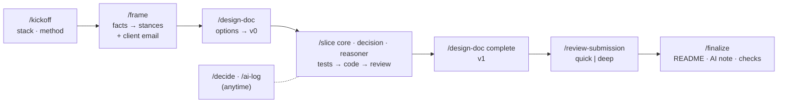

# AI setup: how to drive this take-home with Claude Code

This repo ships a small Claude Code setup in `.claude/`, tuned to one goal: deliver the
Rebooking Copilot brief (`docs/ASSIGNMENT.md`) and score well on its rubric.
Claude does the legwork; **you make every product, methodology and technology decision**. The
setup asks you at fixed points and records the answers in `docs/decisions.md`.

## 1. Quick start
```bash
cd ~/private/Rebooking-Copilot
claude
```
Then, in the session:
1. `/kickoff`: asks about stack, LLM mode, methodology, runtime dependencies and output format. Scaffolds the repo.
2. `/frame`: a scripted per-PNR fact table plus a background analyst. You set the product stances and get an email draft for the assessors. **Send it right away**, then keep going on defaults.
3. `/design-doc`: 2–3 contrasting architectures. You pick the approach and the agent shape. It writes the DESIGN.md v0 skeleton.
4. `/slice core` → `/slice decision` → `/slice reasoner`: test-first. One test-engineer run and one money-safety review, both on `decision`.
5. `/design-doc complete`: the full DESIGN.md v1, matching the code.
6. `/review-submission` (you pick quick or deep) → `/finalize`.

You can `/clear` between phases. All state lives in files, and a SessionStart hook tells Claude where it left off.

## 2. The delivery workflow


| Phase | Command | You decide | Output |
|---|---|---|---|
| 0 Kickoff | `/kickoff` | stack · LLM mode · methodology · runtime deps · output format; confirm the pre-set D-00 rules | `docs/decisions.md`, CLAUDE.md quick reference, skeleton |
| 1 Frame | `/frame [deep]` | autonomy · what counts as a saving (cash vs credit) · hard blocks · FX/point of sale · threshold values · schedule window · tie-break · confidence | `docs/framing.md`, `docs/open-questions.md`, `docs/questions-email.md` |
| 2 Design v0 | `/design-doc [options deep]` | approach · agent shape · which variant to present | DESIGN.md skeleton |
| 3 Build | `/slice <name>` | thinner / stub / skip when a slice outgrows the risky core · anything the tests flag as `needs decision` | tests + code |
| 4 Design v1 | `/design-doc complete` · `/design-doc <section>` · `/design-doc review` | volume/cost scenarios · which assessor fixes to apply | DESIGN.md |
| 5 Review + finalize | `/review-submission` → `/finalize` | review depth · which fixes · what ships · tag/zip/push | submission-ready repo |

Cross-cutting commands:
- **`/decide <topic>`** asks you a structured question (with a recommended option) and records an ADR entry.
  Claude runs it on its own whenever work depends on something undecided.
- **`/ai-log [note]`** feeds the required AI-usage note. Claude also logs automatically when you correct it. Mark strong examples with ★.

## 3. What's in `.claude/`, and why
**Skills** (`.claude/skills/`):

| Skill | Kind | Purpose |
|---|---|---|
| `kickoff`, `frame`, `design-doc`, `slice`, `review-submission`, `finalize` | you invoke them | the phases; each one says exactly when to ask you |
| `decide`, `ai-log` | you or Claude | decisions, AI-usage evidence |
| `rebooking-domain` | knowledge (auto) | fixture contract, equivalence dimensions, fee/credit/point-of-sale semantics, trap questions, production realities |
| `money-safety` | knowledge (auto) | Money type, FX policy hooks, abstain states, invariants to test, audit trail, execution safety |
| `llm-boundary` | knowledge (auto) | code-vs-LLM matrix, agent shapes, Reasoner stub + Claude, prompt/schema/faithfulness/fallback, cost model |

**Agents** (`.claude/agents/`). Each runs in its own context, so its view is independent of the main session:

| Agent | Model | Writes? | Used by |
|---|---|---|---|
| `fixture-analyst` | sonnet | no | `/frame` (one background lens; 4 lenses + synthesis in `deep`) |
| `solution-architect` | opus | no | `/design-doc` options (one agent; 3 angles in `deep`) |
| `test-engineer` | sonnet | tests only | `/slice decision` |
| `money-safety-reviewer` | opus | no | end of `/slice decision`, `/review-submission` |
| `llm-boundary-reviewer` | opus | no | `/review-submission deep` (or ad hoc after `/slice reasoner`) |
| `assessor` | opus | no | `/design-doc review`, `/review-submission` |

**Workflows** (`.claude/workflows/`). Optional multi-agent fan-outs for more independent perspectives. They also
show up as directly invocable commands (`/frame-problem`, `/design-options`, `/review-panel`):

| Workflow | Started by | Agents | Shape |
|---|---|---|---|
| `frame-problem` | `/frame deep` | 5 | 4 analyst lenses → synthesis; only the synthesis comes back to the main context |
| `design-options` | `/design-doc options deep` | 4 | 3 architects (safety-first · judgement-where-it-pays · scale-first) → a neutral judge that also merges the open decisions |
| `review-panel` | `/review-submission` | quick 2–6 · deep ≤10 | quick: assessor + money reviewer, skeptics on critical findings (max 2 each). Deep: + boundary + fresh-clone run, skeptics on critical/high findings (max 3 each). Anything left unverified is reported, never dropped |

If your Claude Code build has no Workflow tool, each skill falls back to launching the same agents in parallel with the Agent tool.

**Guardrails** (`.claude/settings.json` + `.claude/hooks/`):
- `guard.py` (PreToolUse on file tools and Bash) blocks edits to `fixtures/` and any content or command that
  looks like an API key. `guard.py --scan --history` is the secret scan `/finalize` uses.
- `status.py` (SessionStart) shows phase status and the suggested next command, so `/clear` and resume are safe.
- Permissions: read-only git, jq and the secret scan are pre-allowed. `.env` reads are denied. `git push` asks first.
- `.claude/fixtures.sha256`: `/finalize` checks that the fixtures you ran against are byte-identical.

**Context files:**
- `CLAUDE.md`: brief import, rules, phase map, quick reference (filled by `/kickoff`), decision log import.
- `docs/decisions.md`: the source of truth for every choice. It starts with the pre-set D-00 rules, and every subagent sees it.
- `docs/adr/`: Architecture Decision Records for the architecture-significant choices. Each ADR has a
  "Depends on (team & context)" section, and DESIGN.md §10 indexes them.
- `docs/AI_USAGE_LOG.md`: raw material for the AI-usage note.

## 4. Where you'll be asked for input
Every question comes with options, a recommended option and its trade-off, and an "Other" box.
1. **Kickoff:** stack · LLM mode · methodology for the money core · runtime dependencies · output format.
   Defaults are *stated, not asked* (commit cadence, the client email, review depth later), plus a "keep the D-00 rules?" check.
2. **Frame** (two calls of 4): autonomy · cash vs credit · hard blocks (multi-select) · FX/point of sale; then
   threshold values · schedule window · tie-break · confidence. Each question cites the PNRs that illustrate it.
3. **Design v0:** approach · agent shape (pipeline + explainer vs LLM orchestrating deterministic tools) · which variant to present.
4. **Each slice:** build thinner, stub or skip if it outgrows the risky core · anything the tests flag as `needs decision`.
5. **Design v1:** volume scenarios if they're still open · which assessor fixes to apply.
6. **Review and finalize:** review depth · which fixes · what ships · tag/zip/push.

Answer "ask the client" to record a decision as *provisional*. It goes into `docs/open-questions.md` and the
email draft, and work continues on a stated default.

## 5. Guidelines for driving it
- **DESIGN.md is the product.** Code backs it up. Put depth into §3 (LLM boundary), §4 (money safety)
  and §7 (assumptions and questions) before adding features.
- **Send the questions email early**, then keep working on the stated defaults. The brief says they track what candidates ask.
- **Build the risky core only:** money math, eligibility and the decision gate, test-first. Stub the rest and say so.
- **Keep the LLM out of the money path.** Rules, reviewers and invariant tests enforce it, which also means
  Claude rarely proposes the classic bad idea. Your best "rejected or corrected" examples will be reviewer findings
  you overrule, scope Claude wants to add, and corrections to the setup itself. Log them with `/ai-log` and a ★.
- **Make Claude show evidence:** "run it", "show the failing test", "compute that with a script". Numbers in DESIGN.md need stated inputs.
- **Commit at phase boundaries.** The history then reads as your process.
- **Permission mode:** use *accept edits* (or default) while building, so you see every command. At kickoff, accept
  the proposed `settings.local.json` rules for your test and run commands, so subagents don't flood you with prompts.
- **Model:** Opus for kickoff, frame, design and review. Sonnet is fine for routine slices. Agents pin their own model.
- **The deep variants are optional.** Use them when you want more independent perspectives; the quick paths are the default.

## 6. Honesty and disclosure
The knowledge skills are AI-drafted checklists, and they shape DESIGN.md. That's legitimate in a brief that
says to use AI, but disclose it: `/finalize` writes into the AI-usage note that the `.claude/` setup was prepared
with AI before the implementation work. Make the decisions yourself: the setup only proposes options.

## 7. Kick-off checklist (beyond what's already set up)
Done by this setup:
- [x] Brief and fixtures copied into the repo (`docs/ASSIGNMENT.md`, `fixtures/`), fixture checksums recorded
- [x] CLAUDE.md, decision log (with the pre-set D-00 rules), AI-usage log, `.gitignore`, `.env.example`
- [x] 11 skills, 6 agents, 3 workflows, 2 hooks, permissions. Reviewed by two independent agents, and their findings applied
- [x] Setup committed, so the history separates tooling from the implementation work

Still yours:
- [ ] Open the repo in Claude Code and trust the folder. Check that the hooks loaded: the first reply should know the
      `[rebooking-copilot] phases: …` status. In the CLI, `/hooks` lists them and `/agents` shows the 6 agents.
- [ ] Check the toolchain for the stack you'll pick (e.g. `python3 --version` ≥ 3.11, or node). If you choose any
      dependencies, pre-fetch them now so the work doesn't wait on installs.
- [ ] Decide whether to use a real model at all. If yes, `export ANTHROPIC_API_KEY=…` in your shell only. Never put it in a file.
- [ ] Run `/kickoff`.
- [ ] Send the email that `/frame` drafts. It goes to the address in the brief.

Not needed: MCP servers, plugins or network access. The prototype must run offline, and the setup keeps it that way.

## 8. Customising
- **Different slices:** run `/slice <name>` with any name. The three-slice plan in `.claude/skills/slice/SKILL.md` is only a default.
- **Change lenses, angles or reviewers:** edit the `LENSES` / `ANGLES` / `ALL_REVIEWERS` arrays in `.claude/workflows/*.js`.
- **Personal permissions:** `.claude/settings.local.json` (gitignored).

## 9. Troubleshooting
| Symptom | Fix |
|---|---|
| "Blocked by guard.py: … fixtures/ …" | Intended. Put extra data in `tests/`. |
| "Blocked by guard.py: looks like a secret" | Read the key from an env var. If it's a false positive, use a shorter dummy value in test data. |
| Many permission prompts from subagents | Add your test, run and `python3 -c` commands to `.claude/settings.local.json` (kickoff offers this). |
| Workflow tool unavailable | The skills fall back to parallel Agent calls. |
| Claude decided something on its own | Say so. It should `/decide` and log it with `/ai-log`. Tighten CLAUDE.md if it keeps happening. |
